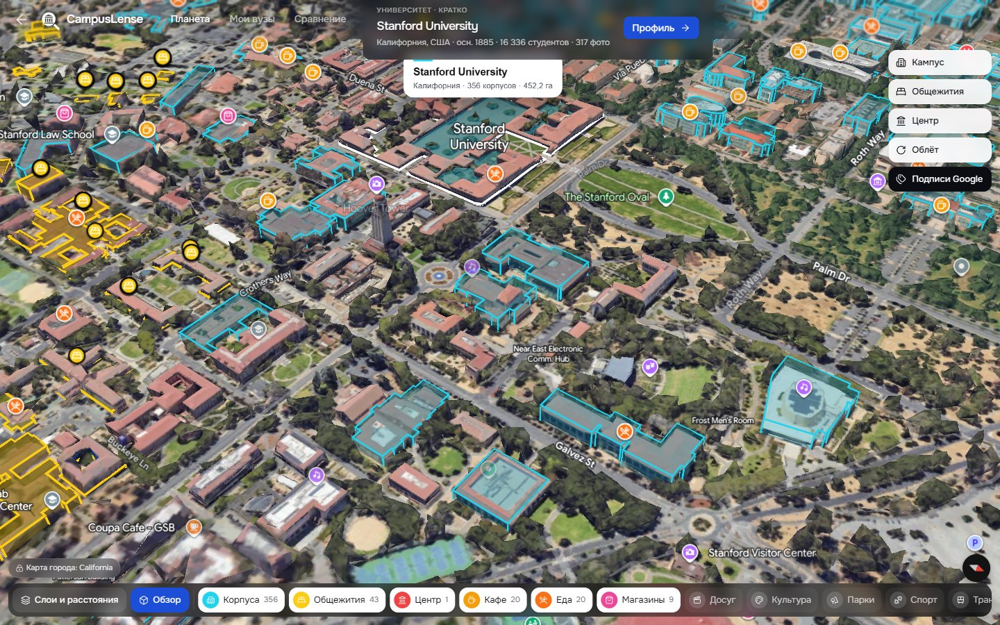
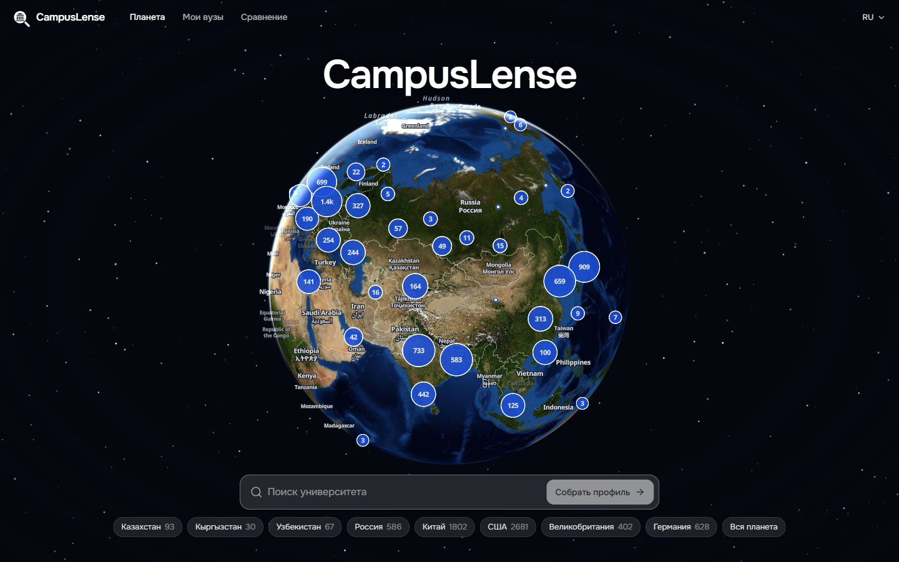
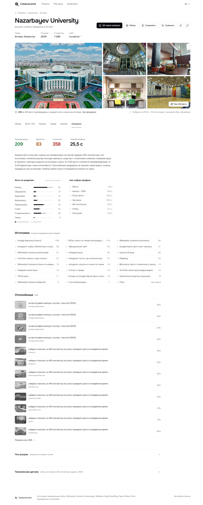
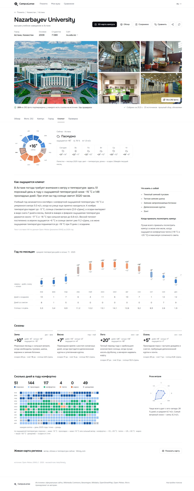
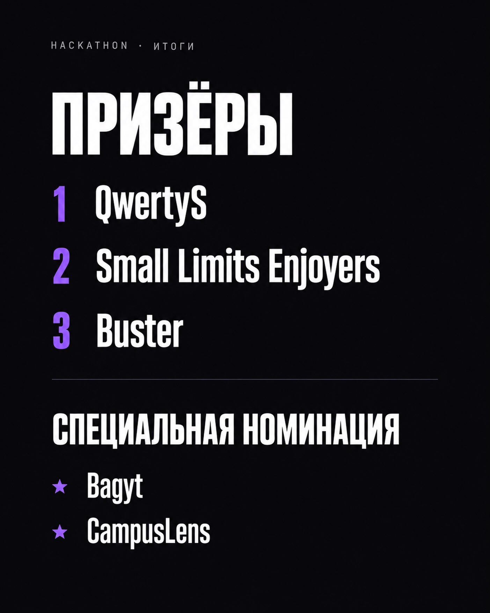

# CampusLense
### Visit the campus before choosing the university.

An interactive globe, cinematic campus visits and university profiles that keep the original evidence close to every photograph. Built by QwertyS for **LOCUS 2026 — first place**.

*Campus exploration in the working prototype: a 3D visit opens alongside the university context.*

[Explore the experience](#from-a-country-to-a-campus) · [Photo verification](#a-photo-is-only-useful-if-it-belongs-there) · [Engineering](#what-happens-behind-a-profile) · [Evaluation](#what-was-measured)

[Open CampusLense](https://nnurkhan91--campuslense-web.modal.run/) ·
[Watch the recorded application demo](media/campuslense-demo.mp4) ·
[Read the submitted pitch](media/CampusLens.pdf) ·
[Explore the public source](https://github.com/Eye172/locus-hackathon-1)

## From a country to a campus

Choosing a university involves more than comparing a ranking and tuition figure. Applicants want to understand where they would live: the buildings, dormitories, surrounding city and climate. Those details are scattered across official pages, image search and promotional brochures.

CampusLense brings discovery and inspection into one workspace. The globe gives the search a geographic starting point; the profile then turns a place into something a student can examine and compare.

*The globe establishes location and context before the user opens an individual university.*

### 1. Find a university without losing your bearings

The search index contains **14,467 universities**. Selecting a result connects the search panel to the map and the campus visit. The flight transition is part of navigation: it conveys the distance between the current view and the selected campus, rather than switching abruptly to another unrelated page.

*Search and geographic exploration share the same workspace.*

### 2. Build a picture of daily life

A university profile groups campus information, photographs, local context and climate. The visitor can move between a 3D exterior, campus material and the surrounding city. This makes it possible to ask practical questions: What do the residences look like? Is this photograph from the campus or merely from the city? What changes between the promotional view and an ordinary campus scene?

Open the full university profile

*The profile assembles the university overview and the next places to explore.*

*Photo categories let a visitor narrow the gallery to a practical topic such as accommodation.*

## A photo is only useful if it belongs there

Image search can return a different campus, an old building, a stock photograph or an attractive image with no useful provenance. CampusLense treats those as a retrieval and verification problem, not just a gallery-layout problem.

The photo passport exposes where an image came from. A separate verification view makes the evidence inspectable; the brochure-versus-reality presentation gives the user a way to compare different kinds of campus imagery. These features support investigation rather than claiming that a model can certify every photograph as authentic.

Open the full brochure / reality gallery

*A side-by-side presentation helps the visitor examine promotional and everyday campus imagery.*

*The photo passport preserves provenance instead of presenting an isolated image as an unquestionable fact.*

*Verification is a visible product workflow, with source context available to the user.*

## Keep the shortlist useful

Climate and comparison sit beside visual exploration. A spectacular campus is only one part of a decision; the student still needs to compare places and return to a shortlist. The interface includes saved universities, comparison and shareable views, with a separate mobile profile layout.

*Climate adds everyday living context to the visual campus visit.*

Open the full comparison view

*The comparison view turns exploration into a shortlist that can be reviewed side by side.*

## What happens behind a profile

~~~mermaid
flowchart LR
 A[University identity] --> B[Parallel source discovery]
 B --> C[Image download and hashing]
 C --> D[Deduplication and CLIP relevance]
 D --> E[Categories and source provenance]
 E --> F[Profile, gallery and photo passport]
 B -. progress events .-> F
~~~

The retrieval pipeline gathers candidate sources in parallel, downloads the underlying images, removes duplicates and applies visual relevance checks. Source information survives the process so that the final interface can show where an image originated. Server-sent events expose progress while the profile is being assembled.

The map and 3D experience run in a **React 19 / TypeScript / Vite** frontend with Tailwind, MapLibre and Google Maps 3D. The service layer uses **Python, FastAPI, SQLite and httpx**; CLIP supports image relevance. Separating the retrieval pipeline from the map keeps expensive discovery work out of the interaction loop.

## What was measured

| Internal evaluation | Reported result | Scope |
|---|---:|---|
| Image relevance precision / recall | 0.94 / 0.94 | A manually labelled set of 223 images |
| Category accuracy | 0.95 | The same project evaluation material |
| Complete profile assembly | About 23 seconds | Recorded internal run; network and sources affect latency |

These are prototype measurements, not a guarantee across the full university index. The useful engineering result is the complete path from a university selection to a navigable, source-backed profile. The screenshots above come from the project’s recorded application walkthrough.

## The LOCUS challenge behind the product

CampusLense was developed for **LOCUS Startup Hackathon 2026**, organized by **LOCUS
Education**, and received **first place**. The organizer's
[final results](https://www.instagram.com/locus_ed/p/Dd8uIpDtT4z/) name **QwertyS** as the
winner; its [Case 01 finalist list](https://www.instagram.com/locus_ed/p/DdjcB1VtlE6/)
identifies **CampusLense (QwertyS)**. The team also retains first-place certificates.

Official LOCUS results

*Original organizer artwork from the [1 October final-results publication](https://www.instagram.com/locus_ed/p/Dd8uIpDtT4z/).
Credit: LOCUS / @locus_ed. Preserved without alteration.*

The event brought together **200 teams**, according to the team's participation record.
An organizer-published overall participation count has not yet been located. The
[25 September winners announcement](https://www.instagram.com/locus_ed/p/DdtuwJZFMaU/)
confirms **13 teams in the final**. The 200-team figure refers to the overall event.

The 72-hour build window ran **16 September, 12:00 to 19 September, 12:00**, with the
final scheduled for **24 September 2026**, using Astana time. The chosen brief was
**Case 01: Visual University Profile**. It asked teams to turn a university name into a
source-backed visual profile, organize photographs by practical categories, remove
duplicates and irrelevant images, and make uncertainty visible.

That brief explains why photo provenance is central to the product. The globe and
3D navigation make the experience engaging, while the retrieval and verification work
answers the actual case. [The challenge record](docs/HACKATHON.md) includes the original
case and regulations, submission media and links to the organizer's announcement.

The images, demo and pitch in this repository document the hackathon product. A proposed
user pilot is not presented as a completed deployment or a measured adoption result.

---

### QwertyS

Jointly developed by **[Nurkhan Aimukatov / pip00sya](https://github.com/pip00sya)** and
**[Shakhnazar Akhmer / Eye172](https://github.com/Eye172)**.
Both are Full-stack, Software and AI Engineers; Shakhnazar also works in ML engineering.
Our shared experience includes product design, application development, AI integration,
testing and preparing working hackathon submissions. We contributed as equal engineering
partners across the project.

This public case study is maintained on Nurkhan's account.
[Companion showcase on Shakhnazar's account](https://github.com/Eye172/campuslense-showcase) ·
[Nurkhan's projects](https://github.com/pip00sya) · [Shakhnazar's projects](https://github.com/Eye172).

[Public implementation and hackathon materials](https://github.com/Eye172/locus-hackathon-1) · [Original team repository](https://github.com/pip00sya/locus) (access depends on repository visibility).

[Hackathon record and supporting sources](docs/HACKATHON.md) ·
[Media provenance](docs/MEDIA.md).
