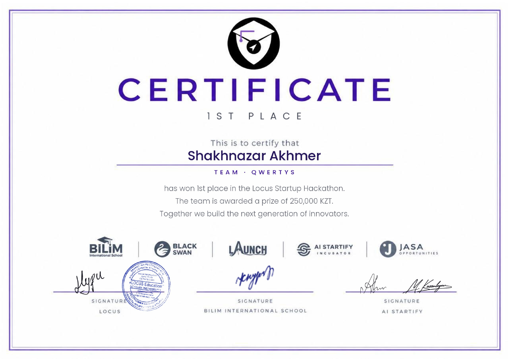

# CampusLense: certificates

**1st place at the LOCUS Startup Hackathon**, team Qwertys. The certificate names Shakhnazar Akhmer and records a **250,000 KZT team prize**.

## LOCUS Startup Hackathon — 1st place, Qwertys

[Open the original document](locus-first-place.pdf)

## Document provenance

Supplied by Shakhnazar Akhmer on 12 October 2026. Original documents are preserved byte for byte; PNG previews of PDFs are page renders. Project associations follow the submitted project records and Shakhnazar’s identification of the events.

[File checksums](manifest.json) · [Back to the project](../../README.md)
