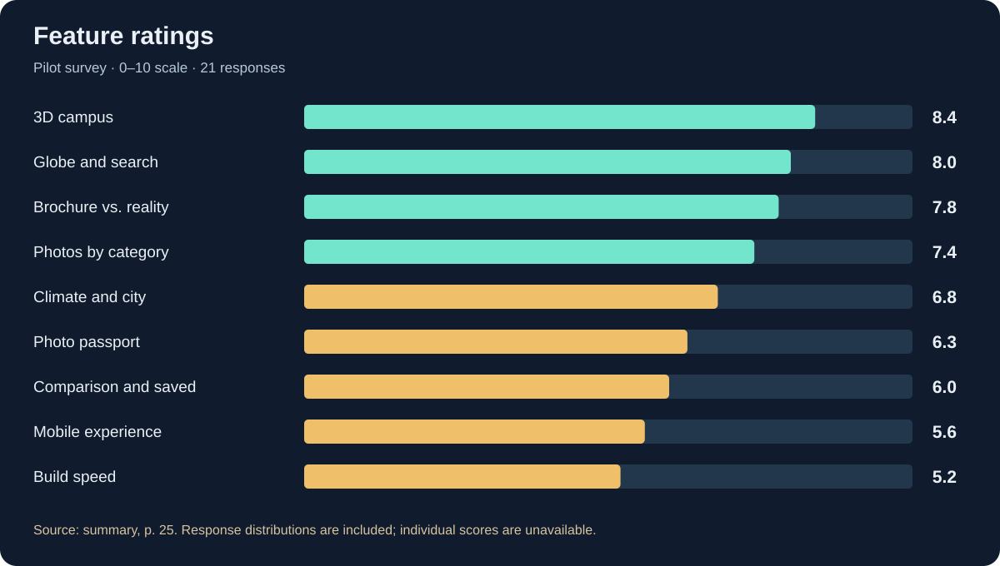

# CampusLense — Pilot Metrics

[Overview](README.md) · [Sources and methodology](METHODOLOGY.md) · [All metrics CSV](data/metrics.csv)

Results of the 1–10 October 2026 pilot, taken from the retained summary document. The project lead confirmed the period and their status as completed-pilot results. Percentages are recalculated from aggregates, with denominators stated where available.

## Outreach and funnel

| Stage | Count | Share and denominator |
|---|---:|---|
| Communities contacted | 14 | — |
| Allowed publication | 9 | 64.3% of 14 |
| Combined community membership | 34,600 | Memberships may overlap |
| Post reach | 11,200 | 32.4% of combined membership |
| Visitors | 486 | 4.3% of post reach |
| Started Google sign-in | 187 | 38.5% of visitors |
| Signed in successfully | 131 | 70.1% of starts; 27.0% of visitors |
| Obtained at least one profile | 104 | 79.4% of accounts; 21.4% of visitors |
| Completed the survey | 21 | 20.2% of activated accounts |

Source: page 21. Combined community membership may count the same person more than once; it is not the site's unique visitor count. [Daily results](README.md#daily-results) and [daily.csv](data/daily.csv) preserve the ten daily rows from page 22.

## Engagement and retention

| Metric | Result | Definition or source |
|---|---:|---|
| Median time to first completed profile | 110 s | From first arrival; page 22 |
| Median session duration | 220 s | Page 22 |
| Profiles per activated account | Mean 4.0; median 3 | 418 / 104 ≈ 4.02; page 22 |
| Unique universities | 263 | Page 22 |
| Reached the quota at least once | 37 / 104 — 35.6% | Rounded to 36% in the source; page 23 |
| Returned the next day after activation | 25 / 104 — 24.0% | Any event on the next calendar day; page 23 |
| Returned on day seven | 5 / 54 — 9.3% | Accounts activated on days 1–3; page 23 |
| Active on three or more distinct days | 11 / 104 — 10.6% | Rounded to 11% in the source; page 23 |

D7 uses the early cohort of 54 accounts activated on days 1–3, allowing a seven-day return to be observed within the pilot period. The original cohort membership is outside this package.

## Feature use

| Feature | Reported share |
|---|---:|
| 3D campus | 81% |
| Photo filter | 63% |
| Brochure vs. reality | 44% |
| Climate and city | 38% |
| Saved universities | 21% |
| Photo passport | 17% |
| University comparison | 12% |
| Link sharing | 9% |
| Mobile devices | 81% |

Source: page 23. A shared denominator for all rows is not explicitly specified. Feature-use percentages are not click or event counts and are not converted into individual user records.

## University countries

| Country or group | Share of requests |
|---|---:|
| Kazakhstan | 34% |
| United States | 21% |
| Korea, China and Hong Kong | 14% |
| Europe | 12% |
| Turkey | 9% |
| Other | 10% |
| **Total** | **100%** |

Source: page 23; [country-distribution.csv](data/country-distribution.csv). These are the countries of requested universities. Visitor geography is not reported separately.

## Technical performance

| Metric | Result | Target in the summary |
|---|---:|---:|
| New build requests | 497 | — |
| Successful builds | 418 — 84.1% | ≥ 95% |
| Abandoned after waiting longer than 45 s | 47 — 9.5% | — |
| Failed builds | 32 — 6.4% | — |
| Median build time | 34 s | ≤ 30 s |
| Build time p95 | 96 s | — |
| Profiles with fewer than 8 photos | 22% | — |
| Mobile LCP p75 | 4.1 s | ≤ 2.5 s |
| INP p75 | 280 ms | ≤ 200 ms |
| CLS | 0.06 | ≤ 0.1 |
| Availability over 10 days | 99.6% | ≥ 99% |

Source: page 24. LCP describes the appearance of the main content, INP describes interaction latency, and CLS describes layout shifts. These metrics do not measure 3D scene FPS. Availability of 99.6% over ten days corresponds to approximately 57.6 minutes of downtime; the source reports about one hour.

The reported categories sum to 418 + 47 + 32 = 497. A user leaving and a background build completing can overlap; task logs are needed to verify exclusivity. Reasons for repeat builds across 263 unique universities are outside this package.

## Survey

| Metric | Result | Target in the summary |
|---|---:|---:|
| Responses | 21 | — |
| SUS | 71 | ≥ 68 |
| NPS | +9.52; +10 rounded | ≥ +20 |
| Promoters / passives / detractors | 7 / 9 / 5 | 21 total |
| Very disappointed if the product disappears | 4 / 21 — 19.0% | ≥ 40% |
| Overall rating | 7.3 / 10 | ≥ 7 |
| Three new profiles are sufficient | 9 / 21 — 42.9% | — |
| Prefer five new profiles | 8 / 21 — 38.1% | — |
| Prefer unlimited profiles | 4 / 21 — 19.0% | — |

Source: page 24. NPS = (7 − 5) / 21 × 100. Raw SUS items and individual responses are outside this package. The small respondent sample does not support generalizing survey results to all visitors.

## Feature ratings

| Feature | Mean | 9–10 | 7–8 | 5–6 | 0–4 |
|---|---:|---:|---:|---:|---:|
| 3D campus | 8.4 | 11 | 8 | 2 | 0 |
| Globe and search | 8.0 | 9 | 9 | 2 | 1 |
| Brochure vs. reality | 7.8 | 8 | 9 | 3 | 1 |
| Photos by category | 7.4 | 5 | 10 | 5 | 1 |
| Climate and city | 6.8 | 3 | 9 | 7 | 2 |
| Photo passport | 6.3 | 3 | 6 | 9 | 3 |
| Comparison and saved universities | 6.0 | 2 | 6 | 9 | 4 |
| Mobile experience | 5.6 | 2 | 5 | 8 | 6 |
| Build speed | 5.2 | 1 | 4 | 9 | 7 |

Source: page 25; [feature-ratings.csv](data/feature-ratings.csv). Every row contains 21 responses grouped into score ranges. Exact scores within each range are unavailable, so means are preserved from the summary. There is no separate "did not use" category.

## Feedback

The pilot received 31 feedback messages from 22 people and 14 bug reports. Individual message texts and author names are excluded. Overlap between feedback messages and bug reports is unspecified.

| Theme | Mentions | Summary |
|---|---:|---|
| Tuition and scholarships | 11 | Request to add to profiles |
| Build speed | 9 | Waiting feels like the application has frozen |
| Admission deadlines and requirements | 8 | Request to add |
| 3D campus | 8 | Positive feedback |
| Google sign-in on mobile | 7 | Unable to sign in from Telegram |
| Dormitories and prices | 6 | Request to add |
| Too few photos of Kazakh universities | 6 | Empty or incomplete profiles |
| Student reviews | 5 | Request to add |
| Photo passport | 4 | Purpose is unclear |
| Kazakh interface | 3 | Request to add |

Source: page 25; [feedback-themes.csv](data/feedback-themes.csv). Mentions may overlap and are not unique respondent counts.

## Pilot criteria

| Criterion | Target | Pilot result | Outcome |
|---|---:|---:|---|
| Activated accounts | ≥ 100 | 104 | Met |
| Visitor-to-account conversion | ≥ 25% | 27.0% | Met |
| Day-seven return | ≥ 10% | 9.3% | Not met |
| SUS | ≥ 68 | 71 | Met |
| NPS | ≥ +20 | +9.52 | Not met |
| Ellis test | ≥ 40% | 19.0% | Not met |
| Successful builds | ≥ 95% | 84.1% | Not met |
| Expenses | ≤ $100 | $30–70 | Met based on the reported range |

Source: page 26; [success-criteria.csv](data/success-criteria.csv). Four of eight criteria were met. CSV percentages retain four decimal places. Expenses preserve the range stated in the summary; [expense information](COSTS.md).
