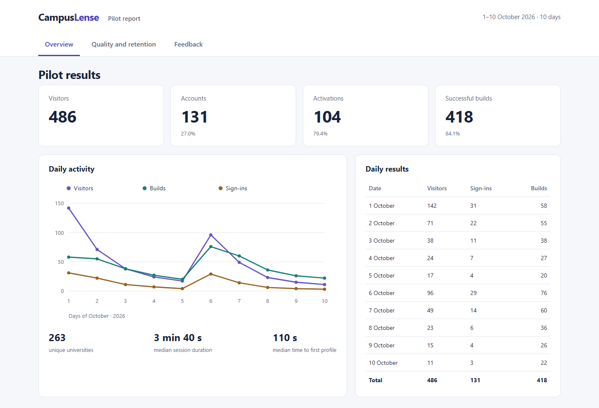
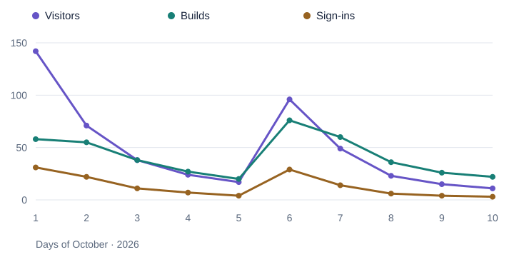

# CampusLense — Pilot Results

**1–10 October 2026 · 10 days · Project lead: Nurkhan**

CampusLense helps applicants explore universities through photographs, a 3D campus, city information, and university comparison. During the pilot, the site recorded **486 visitors**, **131 accounts** signed in successfully, and **104 accounts** obtained at least one completed profile. The service completed **418 profile builds** across **263 unique universities**.

[All metrics](METRICS.md) · [Report images](SCREENSHOTS.md) · [Methodology](METHODOLOGY.md) · [Expenses](COSTS.md) · [Download the standalone dashboard](dashboard.html)

## Key results

| Metric | Result |
|---|---:|
| Visitors | 486 |
| Started Google sign-in | 187 |
| Successfully signed-in accounts | 131 — 27.0% of visitors |
| Activated accounts | 104 — 79.4% of accounts |
| New build requests | 497 |
| Successful builds | 418 — 84.1% |
| Abandoned waits / failed builds | 47 / 32 |
| Unique universities | 263 |
| Next-day return | 25 / 104 — 24.0% |
| Day-seven return | 5 / 54 — 9.3% of the early cohort |
| Survey | 21 responses |
| SUS | 71 / 100 |
| NPS | +9.52; +10 rounded to an integer |
| Overall rating | 7.3 / 10 |

## Daily results

| Date | New visitors | Successful sign-ins | Successful builds |
|---|---:|---:|---:|
| 1 October | 142 | 31 | 58 |
| 2 October | 71 | 22 | 55 |
| 3 October | 38 | 11 | 38 |
| 4 October | 24 | 7 | 27 |
| 5 October | 17 | 4 | 20 |
| 6 October | 96 | 29 | 76 |
| 7 October | 49 | 14 | 60 |
| 8 October | 23 | 6 | 36 |
| 9 October | 15 | 4 | 26 |
| 10 October | 11 | 3 | 22 |
| **Total** | **486** | **131** | **418** |

[Daily data CSV](data/daily.csv). Daily results cover 1–10 October 2026 inclusive.

## What the pilot showed

The highest-rated features were the **3D campus (8.4/10)**, **globe and search (8.0/10)**, and **brochure vs. reality (7.8/10)**. The main weaknesses were **build speed (5.2/10)** and the **mobile experience (5.6/10)**. The most common feedback themes were tuition and scholarships (11 mentions), build speed (9), and admission requirements and deadlines (8).

Median build time was **34 seconds** and p95 was **96 seconds**. The **84.1%** successful build rate was below the 95% target. Mobile LCP p75 was **4.1 seconds**, INP p75 was **280 ms**, and CLS was **0.06**. The priorities are faster profile assembly, clearer waiting feedback, mobile Google sign-in, and mobile usability.

Four of eight pilot criteria were met: activation count, visitor-to-account conversion, SUS, and the budget based on the reported expense range. D7 return, NPS, the Ellis test, and successful builds remained below their targets. [Criteria and denominators](METRICS.md#pilot-criteria).

## Umami captures

English captures of the overview, events, and sessions are included in the [image gallery](SCREENSHOTS.md#umami-overview). They show pilot analytics for 1–10 October, with the displayed metrics explained alongside each image.

## Package contents

| File | Contents |
|---|---|
| [METRICS.md](METRICS.md) | Funnel, retention, feature use, technical performance, survey, ratings, and feedback |
| [SCREENSHOTS.md](SCREENSHOTS.md) | Three summary-report views and three direct Umami captures |
| [METHODOLOGY.md](METHODOLOGY.md) | Data sources, metric definitions, denominators and rounding |
| [COSTS.md](COSTS.md) | Expenses reported in the pilot summary |
| [data](data/) | CSV metrics and distributions; JSON report metadata |
| [dashboard.html](dashboard.html) | Standalone report dashboard with no external requests |
| [checks.json](checks.json) | Arithmetic, links, image, layout, and package checks |
| [file-manifest.json](file-manifest.json) | SHA-256 checksums |
| [verify_report.py](verify_report.py) | Offline verification using the Python standard library |

The public report presents aggregate pilot results, survey distributions and feedback themes. Percentages use the denominators described in the methodology; participant identities and access credentials are not published.
