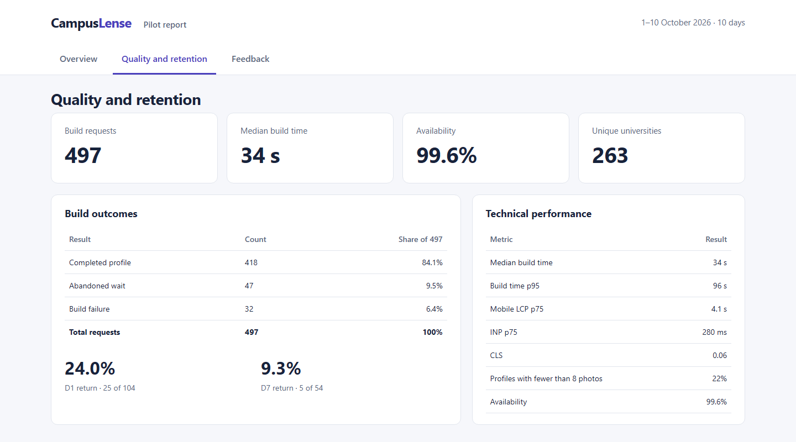
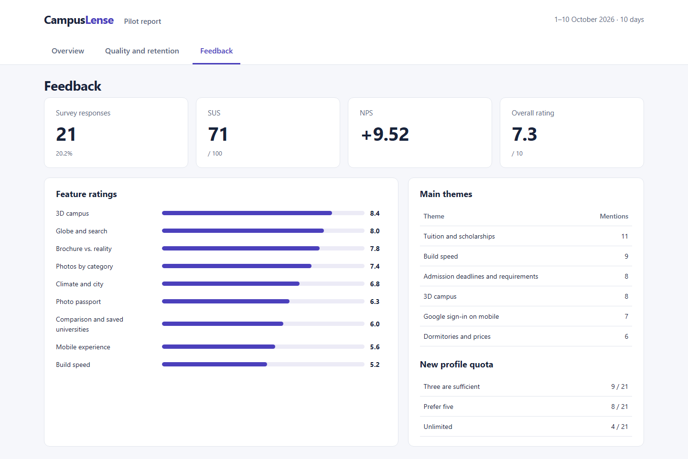
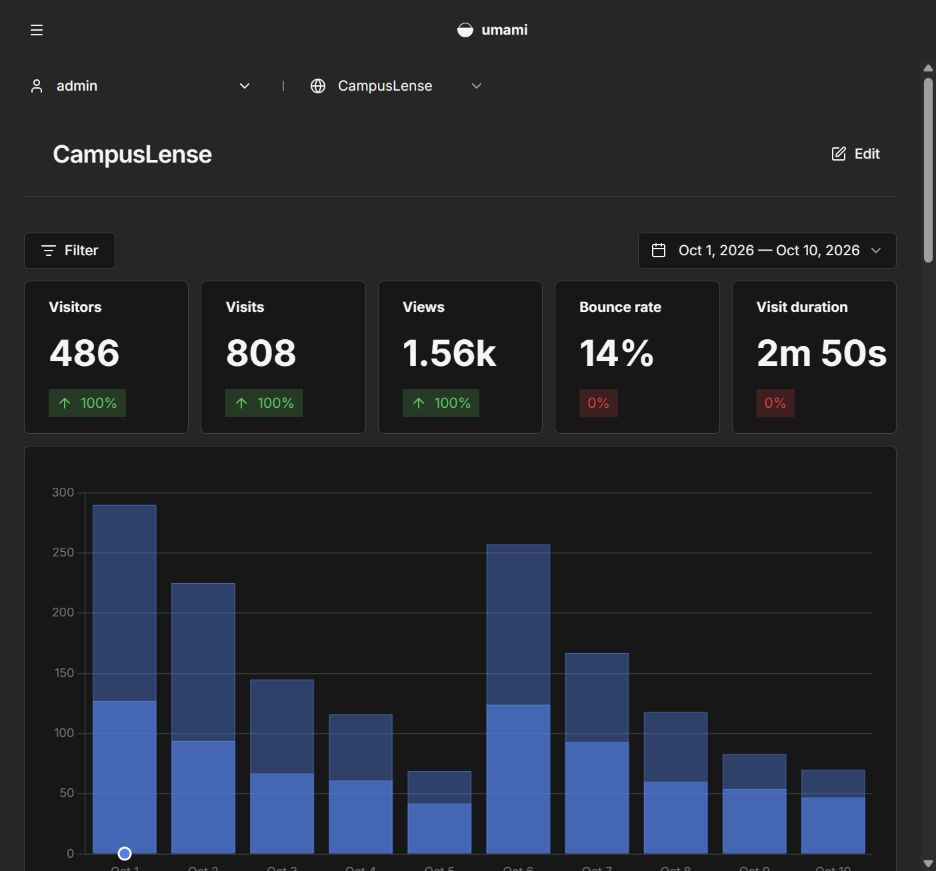
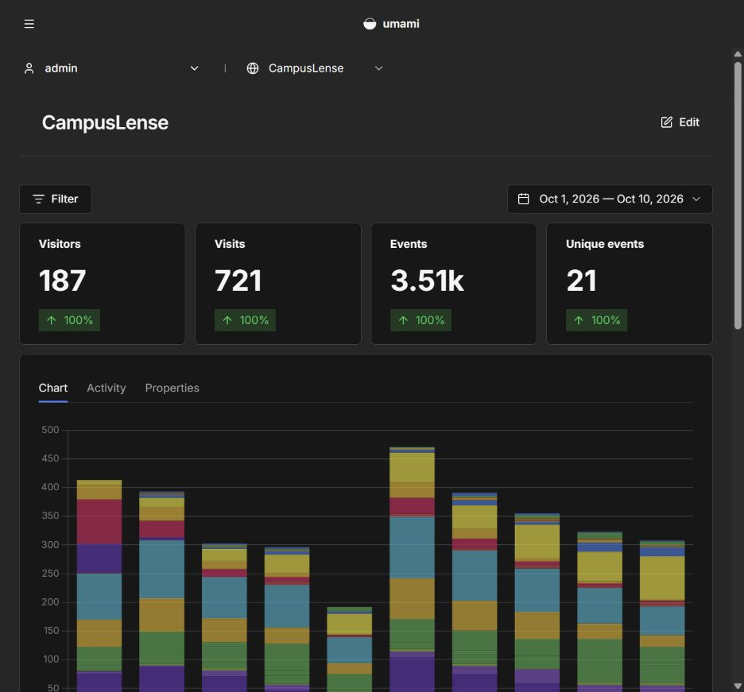
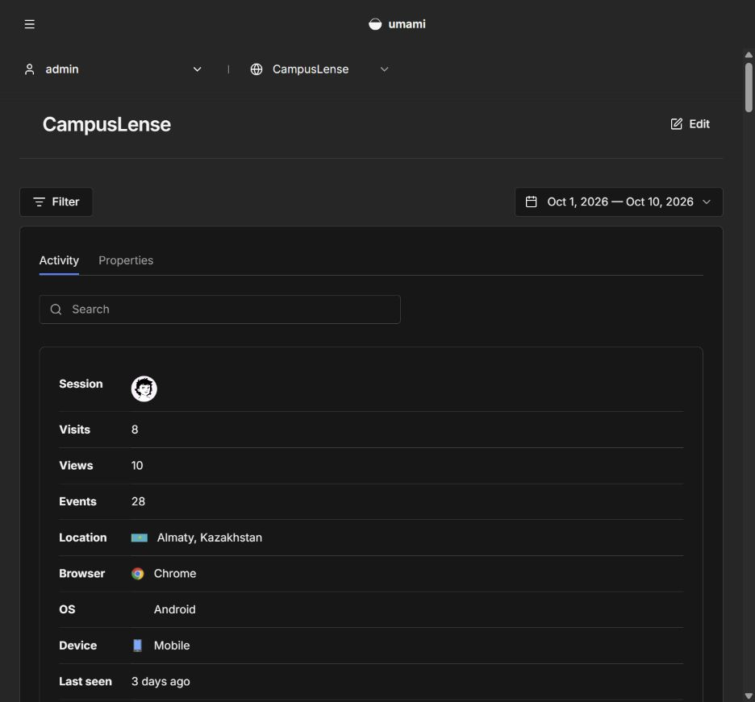

# Pilot Report Images

[Overview](README.md) · [Sources](METHODOLOGY.md) · [Standalone dashboard](dashboard.html)

This package contains three CampusLense summary-report views rendered from the packaged CSV files and three direct captures of the local Umami interface. All views use English. The original event export is outside this package.

## Overview

486 visitors, 131 successfully signed-in accounts, 104 activations, and 418 successful builds. The daily chart shows new visitors, successful builds, and sign-ins. [Daily CSV](data/daily.csv).

## Quality and retention

497 requests: 418 successful builds, 47 abandoned waits, and 32 failures. Median build time is 34 seconds and p95 is 96 seconds. D1 return is 24.0%; D7 return is 9.3% of the early cohort.

## Feedback

21 responses, SUS 71, NPS +9.52, and an overall rating of 7.3/10. Feature means are preserved from the summary. Theme counts represent mentions, not unique participants.

## Umami overview

The displayed overview contains 486 visitors, 808 visits, 1,557 views, a rounded 14% bounce rate, and an average visit duration of 2 min 50 s. The average visit duration is a different statistic from the summary's median session duration of 3 min 40 s. Comparison badges refer to the preceding window in the local database; they are not presented as verified product growth.

## Umami events

The event dashboard shows the event names and counts currently stored in the local Umami database. These counters are preserved in the capture and are not converted into unique account counts unless the definition is explicitly established.

## Umami sessions

The sessions view is captured directly from the same local Umami instance. Stored identifiers and routes are preserved; no individual history or additional participant record was created for these images.

## Capture source

The project lead confirms the figures as pilot data. These screenshots document what the local Umami instance displays. Original collection and import history have not been independently reconciled against a primary event export. The screenshots therefore provide a view of the available database, rather than an independent attestation of the historical collection process. [Capture checks](data/umami-capture-info.json).
